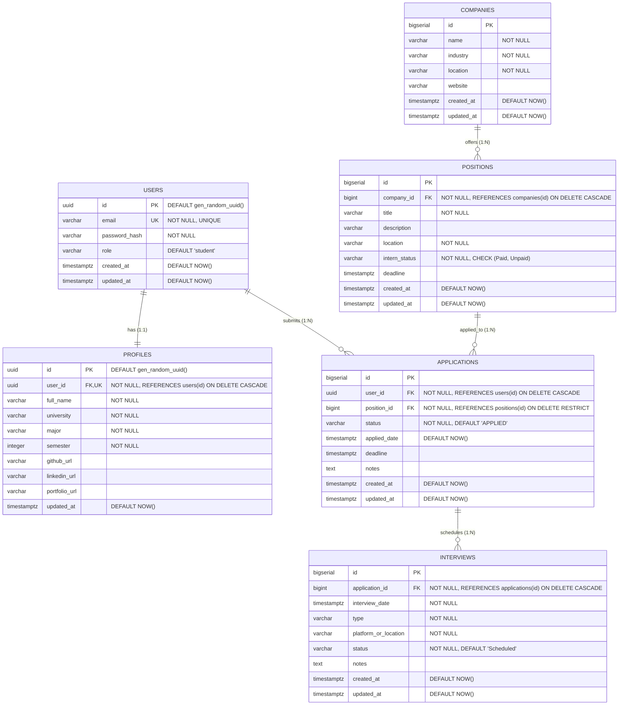

# DOKUMEN AUDIT BACKEND & PERANCANGAN ERD (POSTGRESQL / SUPABASE)
**Proyek:** CareerTrack (Student Career & Application Tracking)  
**Scope Audit:** Modul Backend API (`apps/api`)  
**Tujuan Audit:** Menilai konsistensi backend saat ini, mengidentifikasi kesenjangan (*gap*) antara kode aktual dengan *requirement*, serta merancang *Entity Relationship Diagram* (ERD) dan skema relasional PostgreSQL/Supabase sebelum eksekusi integrasi basis data.

---

## 1. PROJECT STRUCTURE AUDIT

### 1.1. Struktur Direktori Aktual
Berdasarkan penelusuran struktur pada direktori `apps/api`:

```text
apps/api/
├── .env                                # Berkas environment (saat ini kosong / 0 bytes)
├── .gitignore                          # Konfigurasi ignore git
├── package.json                        # Definisi dependensi & skrip eksekusi
├── server.js                           # Entry point server HTTP (port 3000)
├── app.js                              # Konfigurasi Express, middleware global, & route mounting
├── Latihan API/                        # Kumpulan berkas yaml untuk API collection / manual testing
│   ├── Latihan delete.yml
│   ├── Latihan patch.yml
│   ├── Latihan post.yml
│   ├── Latihan put.yml
│   ├── Latihan route api.yml
│   └── opencollection.yml
└── src/
    ├── controllers/                    # Handler logika bisnis & respon HTTP
    │   ├── application.controller.js   # Aktif (In-memory dummy array)
    │   ├── auth.controller.js          # Kosong (0 bytes)
    │   ├── company.controller.js       # Aktif (In-memory dummy array)
    │   ├── dashboard.controller.js     # Kosong (0 bytes)
    │   ├── interview.controller.js     # Aktif (In-memory dummy array)
    │   ├── positions.controller.js     # Aktif (In-memory dummy array)
    │   └── profiles.controller.js      # Aktif (In-memory dummy array)
    ├── middlewares/                    # Middleware layer
    │   ├── auth.middleware.js          # Kosong (0 bytes)
    │   ├── checkPositions.js           # Tidak aktif (seluruh baris kode di-comment)
    │   ├── error.middleware.js         # Aktif (Centralized error handler)
    │   ├── logger.js                   # Tidak aktif (seluruh baris kode di-comment)
    │   └── validation/                 # Middleware validasi payload
    │       ├── application.validate.js # Aktif
    │       ├── auth.validate.js        # Kosong (0 bytes)
    │       ├── company.validate.js     # Aktif
    │       ├── dashboard.validate.js   # Kosong (0 bytes)
    │       ├── interview.validate.js   # Aktif
    │       ├── position.validate.js    # Aktif
    │       └── profile.validate.js     # Aktif
    └── routes/                         # Definisi endpoints & HTTP verbs
        ├── application.routes.js       # Aktif
        ├── auth.routes.js              # Kosong (0 bytes)
        ├── company.routes.js           # Aktif
        ├── dashboard.routes.js         # Kosong (0 bytes)
        ├── interview.routes.js         # Aktif
        ├── positions.routes.js         # Aktif
        └── profiles.routes.js          # Aktif
```

### 1.2. Penilaian Komponen Struktur

| Kategori | Status Temuan | Bukti / Catatan |
|---|---|---|
| **Entry Point** | Terdefinisi | `server.js` mengimpor `app.js` dan menjalankan `app.listen(3000)`. `app.js` menginisialisasi Express dan me-mount routes serta global error handler. |
| **Separation of Concerns** | Terstruktur sebagian | Pemisahan antara routes, controllers, dan middlewares sudah terstruktur rapi. Namun belum ada layer abstraksi database (seperti folder `config/db.js` atau `repositories/`). |
| **Data Storage Layer** | In-Memory (Mocking) | Seluruh controller aktif (`positions`, `company`, `application`, `interview`, `profiles`) menyimpan data langsung di variabel lokal array JavaScript di tingkat file controller. |
| **Berkas Placeholder (0 Bytes)** | Ditemukan | Terdapat 7 file berukuran 0 bytes: `auth.controller.js`, `dashboard.controller.js`, `auth.middleware.js`, `auth.validate.js`, `dashboard.validate.js`, `auth.routes.js`, dan `dashboard.routes.js`. |
| **Berkas yang Dibutuhkan untuk Tahap Database** | Belum Ada | - `src/config/database.js` atau `src/config/db.js` (Koneksi pool `pg` ke Supabase/PostgreSQL).<br>- `src/models/` atau `src/repositories/` (Query builder / Raw SQL repository layer).<br>- Script migration / SQL DDL tables. |

---

## 2. PACKAGE / DEPENDENCIES AUDIT

Berdasarkan inspeksi langsung pada `apps/api/package.json`:

```json
{
  "name": "@careertrack/api",
  "version": "1.0.0",
  "main": "server.js",
  "scripts": {
    "gaskeun": "node --watch server.js",
    "start": "node server.js"
  },
  "dependencies": {
    "express": "^5.1.0"
  }
}
```

### 2.1. Audit Matriks Dependensi

| Dependency | Status di `package.json` | Kategori | Keterangan Evaluasi |
|---|---|---|---|
| **express** | **Sudah Ada** (`^5.1.0`) | Dependensi Utama | Menggunakan versi Express 5 terbaru. Mendukung native promise rejection pada route handler. |
| **pg** | **Belum Ada** | Dependensi Wajib (DB) | Wajib dipasang untuk koneksi raw SQL client pool ke Supabase/PostgreSQL. |
| **dotenv** | **Belum Ada** | Dependensi Wajib (Config) | Berkas `.env` sudah ada, namun modul `dotenv` belum dipasang sehingga `process.env` dari `.env` belum dapat dibaca secara otomatis. |
| **bcrypt / bcryptjs** | **Belum Ada** | Dependensi Wajib (Auth) | Belum tersedia untuk hashing password registrasi/login pengguna. |
| **jsonwebtoken** | **Belum Ada** | Dependensi Wajib (Auth) | Belum tersedia untuk penerbitan dan verifikasi token autentikasi. |

### 2.2. Audit Skrip Eksekusi
* `"start": "node server.js"`: Skrip standar eksekusi production.
* `"gaskeun": "node --watch server.js"`: Menggunakan flag native Node.js `--watch` (fitur Node.js 18+), tanpa memerlukan dependensi pihak ketiga seperti `nodemon`.

---

## 3. API ROUTES AUDIT

### 3.1. Tabel Pendaftaran Seluruh Endpoint

Audit pendaftaran route berdasarkan apa yang **benar-benar terpasang** di `app.js` dan route file terkait:

| Feature | Method | Endpoint Terdaftar Aktual | Controller Handler | Middleware Aktif | Status Implementasi |
|---|---|---|---|---|---|
| **Positions** | GET | `/api/positions` | `getAllPositions` | - | **IMPLEMENTED** (In-Memory) |
| **Positions** | GET | `/api/positions/:id` | `getPositionById` | - | **IMPLEMENTED** (In-Memory) |
| **Positions** | POST | `/api/positions` | `postAllPosition` | `validatePosition` | **IMPLEMENTED** (In-Memory) |
| **Positions** | PUT | `/api/positions/:id` | `putPositionById` | `validatePosition` | **IMPLEMENTED** (In-Memory) |
| **Positions** | DELETE | `/api/positions/:id` | `delPositionById` | - | **IMPLEMENTED** (In-Memory) |
| **Positions** | PATCH | `/api/positions/:id` | - | - | **NOT IMPLEMENTED** (Di-comment di `positions.routes.js:31`) |
| **Companies** | GET | `/api/companies` | `getAllCompanies` | - | **IMPLEMENTED** (In-Memory) |
| **Companies** | GET | `/api/companies/:id` | `getCompanyById` | - | **IMPLEMENTED** (In-Memory) |
| **Companies** | POST | `/api/companies` | `postAllCompany` | `validateCompany` | **IMPLEMENTED** (In-Memory) |
| **Companies** | PUT | `/api/companies/:id` | `putCompanyById` | `validateCompany` | **IMPLEMENTED** (In-Memory) |
| **Companies** | DELETE | `/api/companies/:id` | `delCompanyById` | - | **IMPLEMENTED** (In-Memory) |
| **Applications** | GET | `/api/applications` | `getAllApplications` | - | **IMPLEMENTED** (In-Memory) |
| **Applications** | GET | `/api/applications/:id` | `getApplicationById` | - | **IMPLEMENTED** (In-Memory) |
| **Applications** | POST | `/api/applications` | `createApplication` | `validateApplicationBody` | **IMPLEMENTED** (In-Memory) |
| **Applications** | PUT | `/api/applications/:id` | `updateApplication` | `validateApplicationBody` | **IMPLEMENTED** (In-Memory) |
| **Applications** | PATCH | `/api/applications/:id` | `patchApplication` | - | **CONFLICT** (Tersedia di `/:id`, bukan `/:id/status`) |
| **Applications** | DELETE | `/api/applications/:id` | `deleteApplication` | - | **IMPLEMENTED** (In-Memory) |
| **Interviews** | GET | `/api/interview` | `getAllInterviews` | - | **CONFLICT** (Mounting singular `/api/interview`, bukan plural) |
| **Interviews** | GET | `/api/interview/:id` | `getInterviewById` | - | **CONFLICT** (Mounting singular `/api/interview/:id`, bukan plural) |
| **Interviews** | POST | `/api/interview` | `createInterview` | `validateInterviewBody` | **CONFLICT** (Mounting singular `/api/interview`, bukan plural) |
| **Interviews** | PUT | `/api/interview/:id` | `updateInterview` | `validateInterviewBody` | **CONFLICT** (Mounting singular `/api/interview/:id`, bukan plural) |
| **Interviews** | DELETE | `/api/interview/:id` | `deleteInterview` | - | **CONFLICT** (Mounting singular `/api/interview/:id`, bukan plural) |
| **Profiles** | GET | `/api/profiles` | `getAllProfiles` | - | **CONFLICT** (Mounting plural `/api/profiles`, bukan `/api/profile`) |
| **Profiles** | PUT | `/api/profiles/:id` | `putProfileById` | `validateProfile` | **CONFLICT** (Menggunakan parameter `/:id`, requirement singular tanpa ID) |
| **Authentication**| POST | `/api/auth/register` | - | - | **NOT IMPLEMENTED** (File kosong & rute belum di-mount) |
| **Authentication**| POST | `/api/auth/login` | - | - | **NOT IMPLEMENTED** (File kosong & rute belum di-mount) |
| **Dashboard** | GET | `/api/dashboard` | - | - | **NOT IMPLEMENTED** (File kosong & rute belum di-mount) |

---

### 3.2. Detail Evaluasi & Konflik Khusus per Fitur

#### A. Companies
* **Ekspektasi Requirement:**
  * `GET /api/companies`, `POST /api/companies`, `GET /api/companies/:id`, `PUT /api/companies/:id`, `DELETE /api/companies/:id`
* **Kondisi Aktual di Kode:**
  * Terdaftar secara presisi di `app.js:16` (`app.use("/api/companies", CompanyRouter)`) dan `src/routes/company.routes.js:16-20`.
* **Status:** **SUDAH SESUAI**.

#### B. Positions
* **Ekspektasi Requirement:**
  * `GET /api/positions`, `POST /api/positions`, `GET /api/positions/:id`, `PUT /api/positions/:id`, `DELETE /api/positions/:id`
  * Ketentuan: "Position TIDAK menggunakan PATCH."
* **Kondisi Aktual di Kode:**
  * Terdaftar di `app.js:15` (`app.use("/api/positions", PositionRouter)`).
  * Di `src/routes/positions.routes.js:30-31`, rute `PATCH /:id` dinonaktifkan (di-comment).
* **Status:** **SUDAH SESUAI**.

#### C. Applications
* **Ekspektasi Requirement:**
  * `GET /api/applications`, `POST /api/applications`, `GET /api/applications/:id`, `PUT /api/applications/:id`, `PATCH /api/applications/:id/status`, `DELETE /api/applications/:id`
* **Kondisi Aktual di Kode:**
  * Terdaftar di `app.js:17` (`app.use("/api/applications", ApplicationRouter)`).
  * Pada `src/routes/application.routes.js:15`, endpoint PATCH terdaftar sebagai:
    ```javascript
    router.patch('/:id', patchApplication);
    ```
  * **Bukti Konflik:** Endpoint yang terdaftar adalah `PATCH /api/applications/:id`, **bukan** `PATCH /api/applications/:id/status`. Selain itu, fungsi `patchApplication` di `application.controller.js:83-101` menerima mutasi field `company`, `position`, `status`, dan `deadline`, bukan eksklusif field `status`.

#### D. Interviews
* **Ekspektasi Requirement:**
  * Plural: `GET /api/interviews`, `POST /api/interviews`, `GET /api/interviews/:id`, `PUT /api/interviews/:id`, `DELETE /api/interviews/:id`
* **Kondisi Aktual di Kode:**
  * Pada `app.js:18`, router di-mount sebagai **singular**:
    ```javascript
    app.use("/api/interview", InterviewRouter);
    ```
  * Akibatnya, endpoint yang aktif saat ini adalah `/api/interview` dan `/api/interview/:id`.
  * **Bukti Konflik:** Terdapat inkonsistensi naming convention (endpoint menggunakan singular `/api/interview`, sedangkan entitas lain menggunakan plural `/api/companies`, `/api/positions`, `/api/applications`).

#### E. Profile
* **Ekspektasi Requirement:**
  * Singular: `GET /api/profile`, `PUT /api/profile`.
  * Ketentuan: "Profile menggunakan endpoint singular `/api/profile`. Profile TIDAK menggunakan `/:id`."
* **Kondisi Aktual di Kode:**
  * Pada `app.js:19`, router di-mount sebagai **plural**:
    ```javascript
    app.use("/api/profiles", ProfileRouter);
    ```
  * Pada `src/routes/profiles.routes.js:14-17`:
    ```javascript
    router.get("/", getAllProfiles);
    router.put("/:id", validateProfile, putProfileById);
    ```
  * **Bukti Konflik:**
    1. Menggunakan plural `/api/profiles` alih-alih `/api/profile`.
    2. Endpoint update mewajibkan parameter ID (`PUT /api/profiles/:id`), padahal pada konsep user authentication, profil adalah data milik user yang sedang terotentikasi sehingga tidak membutuhkan param ID di URL.
    3. Method `GET` mengembalikan array dari seluruh profil orang lain (`getAllProfiles`), bukan objek profil tunggal milik user yang sedang aktif.

#### F. Authentication & Dashboard
* **Ekspektasi Requirement:**
  * `POST /api/auth/register`, `POST /api/auth/login`, `GET /api/dashboard`.
* **Kondisi Aktual di Kode:**
  * File `src/routes/auth.routes.js`, `src/routes/dashboard.routes.js`, `src/controllers/auth.controller.js`, dan `src/controllers/dashboard.controller.js` seluruhnya kosong (0 bytes).
  * Di `app.js`, kedua router tersebut **tidak pernah di-import dan tidak di-mount**.
* **Status:** **NOT IMPLEMENTED**.

---

## 4. CONTROLLER AUDIT (10-POINT EVALUATION PER CONTROLLER)

### 4.1. `company.controller.js`
1. **Kesesuaian dengan Route:** Sesuai. Seluruh fungsi (`getAllCompanies`, `getCompanyById`, `postAllCompany`, `putCompanyById`, `delCompanyById`) terhubung ke route masing-masing.
2. **Parameter `req.params`:** Benar. Menggunakan `parseInt(req.params.id, 10)` untuk pencarian id pada array dummy.
3. **Payload `req.body`:** Sesuai API contract (`name`, `industry`, `location`, `website`).
4. **HTTP Status Code:** Sesuai (200 untuk OK, 201 untuk created, 404 untuk not found).
5. **Format Response:** Konsisten mengembalikan objek tunggal atau array JSON. Respon delete mengembalikan `{ message: "Company deleted successfully" }`.
6. **Penanganan Resource 404:** Ditangani dengan baik. Jika id tidak ditemukan, mengembalikan status 404.
7. **Penerusan Error ke Middleware:** **Diteruskan.** Menggunakan pola `const error = new Error("Company Not Found"); error.status = 404; return next(error);`.
8. **Penggunaan Dummy Array:** **Ya.** Menggunakan in-memory array lokal `const companies = [...]` (baris 1-16).
9. **Ketergantungan pada Database:** **Belum ada.** Tidak ada interaksi I/O database.
10. **Business Logic & ID Generation:** Logika `newCompany.id = companies.length + 1` rentan terjadi tabrakan ID (*id collision*) jika terjadi operasi delete sebelumnya. Logika ini wajib didelegasikan ke auto-increment/sequence di database.

---

### 4.2. `positions.controller.js`
1. **Kesesuaian dengan Route:** Sesuai. Method `getAllPositions`, `getPositionById`, `postAllPosition`, `putPositionById`, `delPositionById` terdaftar.
2. **Parameter `req.params`:** Benar. Menggunakan `parseInt(req.params.id, 10)`.
3. **Payload `req.body`:** Menggunakan `{ name, industry, location, InternStatus }`. Catatan: field di dummy data bernama `name` dan `InternStatus`, sedangkan di requirement perancangan aplikasi nama lowongan adalah `title` atau `job_title` dan berelasi dengan `company_id`.
4. **HTTP Status Code:** Sesuai (200, 201, 404).
5. **Format Response:** Format respon data konsisten mengembalikan JSON.
6. **Penanganan Resource 404:** Ditangani jika item tidak ditemukan.
7. **Penerusan Error ke Middleware:** **Inkonsisten!**
   * Pada `getPositionById` (baris 30-35): Error 404 diteruskan ke middleware (`return next(error)`).
   * Pada `putPositionById` (baris 69-71): Error 404 dikirim **langsung** melalui `res.status(404).json({ error: "Position Not Found" })` tanpa memanggil `next(error)`.
   * Pada `delPositionById` (baris 109-111): Error 404 dikirim **langsung** melalui `res.status(404).json(...)`.
8. **Penggunaan Dummy Array:** **Ya.** Menggunakan array lokal `const positions = [...]` (baris 1-24).
9. **Ketergantungan pada Database:** **Belum ada.**
10. **Business Logic & ID Generation:** Menggunakan `positions.length + 1`. Tidak ada validasi relasi terhadap entitas `companies`.

---

### 4.3. `application.controller.js`
1. **Kesesuaian dengan Route:** Terhubung ke route `src/routes/application.routes.js`.
2. **Parameter `req.params`:** Benar. Menggunakan `parseInt(req.params.id, 10)`.
3. **Payload `req.body`:** Menerima `{ company, position, status, deadline }`.
   * **Catatan Kritis:** Controller memperlakukan `company` dan `position` sebagai string teks biasa, bukan sebagai relasi foreign key (`company_id` atau `position_id`). Belum ada kepemilikan `user_id`.
4. **HTTP Status Code:** Sesuai (200, 201, 404).
5. **Format Response:** Mengembalikan JSON data atau objek status.
6. **Penanganan Resource 404:** Ditangani di setiap method (get by id, update, patch, delete).
7. **Penerusan Error ke Middleware:** **TIDAK PERNAH.** Seluruh penanganan 404 di `application.controller.js` (baris 38, 76, 97, 115) menggunakan respons langsung:
   ```javascript
   res.status(404).json({ error: "Application Not Found" });
   ```
   Tidak satupun yang memanggil `next(error)`. Ini berbeda dengan standar yang diterapkan di `company.controller.js`.
8. **Penggunaan Dummy Array:** **Ya.** Menggunakan array lokal `const applications = [...]` (baris 1-23).
9. **Ketergantungan pada Database:** **Belum ada.**
10. **Business Logic:** Fungsi `patchApplication` memperbolehkan mutasi parsial untuk semua field (`company`, `position`, `status`, `deadline`), padahal semestinya pada tahapan pelacakan karir, rute ini hanya digunakan untuk transisi status (`status`).

---

### 4.4. `interview.controller.js`
1. **Kesesuaian dengan Route:** Terhubung ke `src/routes/interview.routes.js`.
2. **Parameter `req.params`:** Benar. Menggunakan `parseInt(req.params.id, 10)`.
3. **Payload `req.body`:** Menerima `{ application_id, company, position, interview_date, type, status }`.
   * **Catatan Redundansi:** Controller menyimpan `company` dan `position` berulang kali di entitas interview, padahal data tersebut sudah melekat pada `application_id`.
4. **HTTP Status Code:** Sesuai (200, 201, 404).
5. **Format Response:** Konsisten mengembalikan objek item atau array.
6. **Penanganan Resource 404:** Ditangani jika item tidak ditemukan.
7. **Penerusan Error ke Middleware:** **TIDAK PERNAH.** Seluruh penanganan 404 menggunakan respons langsung `res.status(404).json({ error: "Interview Not Found" })` tanpa `next(error)`.
8. **Penggunaan Dummy Array:** **Ya.** Menggunakan array lokal `const interviews = [...]` (baris 1-20).
9. **Ketergantungan pada Database:** **Belum ada.**
10. **Business Logic:** Tidak ada pengecekan referensial apakah `application_id` yang dikirim benar-benar eksis di entitas `applications`. Pada arsitektur database, hal ini harus dijaga oleh *Foreign Key constraint*.

---

### 4.5. `profiles.controller.js`
1. **Kesesuaian dengan Route:** Terhubung ke `src/routes/profiles.routes.js`.
2. **Parameter `req.params`:** Menggunakan `parseInt(req.params.id, 10)`.
   * **Bukti Konflik:** Pada kontrak profil personal (singular), data diambil dari token user (`req.user.id`), bukan dari parameter URL `/:id`.
3. **Payload `req.body`:** Menerima `{ name, university, major, semester, github, linkedin, portfolio }`.
4. **HTTP Status Code:** Sesuai (200, 404).
5. **Format Response:** `getAllProfiles` mengembalikan array daftar seluruh profil mahasiswa (bukan profil tunggal).
6. **Penanganan Resource 404:** Ditangani.
7. **Penerusan Error ke Middleware:** **Diteruskan.** Pada baris 38-41 menggunakan `const error = new Error("Profile Not Found"); error.status = 404; return next(error);`.
8. **Penggunaan Dummy Array:** **Ya.** Menggunakan array lokal `const profiles = [...]` (baris 1-22).
9. **Ketergantungan pada Database:** **Belum ada.**
10. **Business Logic:** Belum terdapat relasi `user_id` yang mengaitkan profil dengan akun autentikasi.

---

### 4.6. `auth.controller.js` & `dashboard.controller.js`
* **Status:** **NOT IMPLEMENTED (0 Bytes)**.
* **Evaluasi:** Kedua berkas masih berupa file kosong tanpa baris kode sama sekali.

---

## 5. GAP & CONFLICT ANALYSIS (DESAIN VS IMPLEMENTASI SAAT INI)

| No | Topik Audit | Desain / Target Requirement | Implementasi Aktual di Kode | Dampak / Risiko Jika Langsung Masuk DB |
|:---:|---|---|---|---|
| **1** | **Endpoint Naming: Interview** | Plural: `/api/interviews` | Singular: `app.use("/api/interview", ...)` di `app.js:18` | Client frontend akan mengalami error `404 Not Found` jika mengakses route plural sesuai standar REST. |
| **2** | **Endpoint Naming: Profile** | Singular: `GET /api/profile` dan `PUT /api/profile` tanpa param ID | Plural & Parameter: `GET /api/profiles` dan `PUT /api/profiles/:id` di `app.js:19` | Mahasiswa dapat melihat profil mahasiswa lain dan mengedit profil sembarang user via manipulasi `id` di URL. |
| **3** | **Endpoint PATCH Application** | `PATCH /api/applications/:id/status` | `PATCH /api/applications/:id` | Rute tidak spesifik; payload menerima mutasi data di luar status lamaran. |
| **4** | **Struktur Relasi Application** | Application merujuk ke `user_id` dan `position_id` | Application menyimpan plain text `company` dan `position` | Redundansi data; data application tidak terhubung dengan tabel `companies` dan `positions` yang sudah ada. |
| **5** | **Struktur Relasi Position** | Position dimiliki oleh Company (`company_id`) | Position hanya memiliki teks `industry` tanpa referensi ID company | Tidak dapat mengetahui perusahaan mana yang membuka lowongan tersebut secara relasional. |
| **6** | **Pola Error Handling** | Terpusat via `next(error)` ke `error.middleware.js` | Bercabang: sebagian memakai `next(error)`, sebagian `res.status(404).json(...)` | Format error tidak seragam di layer client; stack trace atau custom logging tidak terpantau secara terpusat. |
| **7** | **ID Generation Logic** | Auto-increment / UUID dari Database engine | `array.length + 1` | Tabrakan primary key jika ada baris data yang dihapus lalu dilakukan penambahan baru. |

---

## 6. ANALISIS ALUR BISNIS PROYEK

Alur sistem CareerTrack berpusat pada siklus pencarian karir mahasiswa:

```
[1. User Registration & Auth]
        │
        ├──> [2. User Profile Setup (1:1)]
        │
[3. Browse Companies & Positions (Katalog Lowongan)]
        │
        ▼
[4. Create Application (Track Lowongan)]
   (Status: WISHLIST -> APPLIED -> ASSESSMENT -> INTERVIEW -> OFFER / REJECTED)
        │
        ├── (Jika Status = INTERVIEW)
        ▼
[5. Create Interview Schedule (1:N)]
   (Mencatat tanggal, link/lokasi, dan tipe interview)
        │
        ▼
[6. Dashboard & Analytics]
   (Agregasi otomatis metrik lamaran & rasio penerimaan)
```

1. **User & Profile:** Setiap mahasiswa memiliki 1 akun login (`users`) dan tepat 1 profil akademik/karier (`profiles`).
2. **Katalog Perusahaan & Lowongan:** Satu perusahaan (`companies`) dapat membuka banyak lowongan magang/pekerjaan (`positions`).
3. **Pelacakan Lamaran:** Mahasiswa memilih posisi pekerjaan dan memasukkannya ke daftar pelacakan (`applications`). Di sini tercatat status terkini (*WISHLIST, APPLIED, ASSESSMENT, INTERVIEW, OFFER, REJECTED, WITHDRAWN*).
4. **Jadwal Interview:** Satu lamaran yang telah mencapai tahap wawancara dapat memiliki satu atau lebih sesi wawancara (`interviews`), misalnya wawancara HR, User, dan Direksi.
5. **Dashboard Analytics:** Tidak memerlukan tabel database baru, melainkan melakukan query `COUNT`, `GROUP BY`, dan filter waktu dari data `applications` dan `interviews` milik user yang sedang aktif.

---

## 7. PERANCANGAN ERD (POSTGRESQL / SUPABASE)

Berdasarkan analisis alur bisnis dan perbaikan struktur data dari dummy array, berikut adalah rancangan skema basis data relasional ternormalisasi (3NF) untuk PostgreSQL / Supabase.

### 7.1. Entity Relationship Diagram (Mermaid)



---

### 7.2. Kamus Data & Spesifikasi Entitas

#### 1. Tabel `users`
Menyimpan kredensial autentikasi pengguna. Jika menggunakan Supabase Auth terintegrasi, tabel ini dapat memanfaatkan `auth.users`, atau dikelola mandiri via tabel publik.

| Kolom | Tipe Data | Constraint | Keterangan |
|---|---|---|---|
| `id` | `UUID` | PRIMARY KEY, `DEFAULT gen_random_uuid()` | Pengenal unik user |
| `email` | `VARCHAR(255)` | UNIQUE, NOT NULL | Alamat email untuk login |
| `password_hash` | `VARCHAR(255)` | NOT NULL | Password terenkripsi menggunakan bcrypt |
| `role` | `VARCHAR(50)` | NOT NULL, DEFAULT `'student'` | Role pengguna |
| `created_at` | `TIMESTAMPTZ` | NOT NULL, DEFAULT `NOW()` | Waktu registrasi |
| `updated_at` | `TIMESTAMPTZ` | NOT NULL, DEFAULT `NOW()` | Waktu update data |

#### 2. Tabel `profiles`
Menyimpan profil detail mahasiswa yang terhubung 1:1 dengan `users`.

| Kolom | Tipe Data | Constraint | Keterangan |
|---|---|---|---|
| `id` | `UUID` | PRIMARY KEY, `DEFAULT gen_random_uuid()` | Pengenal unik profil |
| `user_id` | `UUID` | UNIQUE, NOT NULL, FK `users(id)` ON DELETE CASCADE | Relasi 1:1 ke tabel users |
| `full_name` | `VARCHAR(100)` | NOT NULL | Nama lengkap mahasiswa |
| `university` | `VARCHAR(150)` | NOT NULL | Nama perguruan tinggi |
| `major` | `VARCHAR(100)` | NOT NULL | Jurusan / Program studi |
| `semester` | `INT` | NOT NULL, `CHECK (semester > 0)` | Semester perkuliahan saat ini |
| `github_url` | `VARCHAR(255)` | NULL | Tautan profil GitHub |
| `linkedin_url` | `VARCHAR(255)` | NULL | Tautan profil LinkedIn |
| `portfolio_url` | `VARCHAR(255)` | NULL | Tautan website portfolio |
| `updated_at` | `TIMESTAMPTZ` | NOT NULL, DEFAULT `NOW()` | Waktu modifikasi profil |

#### 3. Tabel `companies`
Katalog direktori perusahaan.

| Kolom | Tipe Data | Constraint | Keterangan |
|---|---|---|---|
| `id` | `BIGSERIAL` | PRIMARY KEY | ID identifikasi perusahaan |
| `name` | `VARCHAR(150)` | NOT NULL | Nama perusahaan |
| `industry` | `VARCHAR(100)` | NOT NULL | Sektor industri (e.g. Technology, Telecom) |
| `location` | `VARCHAR(150)` | NOT NULL | Lokasi kantor pusat/cabang |
| `website` | `VARCHAR(255)` | NULL | Alamat situs resmi |
| `created_at` | `TIMESTAMPTZ` | NOT NULL, DEFAULT `NOW()` | Waktu penambahan data |
| `updated_at` | `TIMESTAMPTZ` | NOT NULL, DEFAULT `NOW()` | Waktu update data |

#### 4. Tabel `positions`
Katalog posisi lowongan magang / pekerjaan yang ditawarkan oleh perusahaan.

| Kolom | Tipe Data | Constraint | Keterangan |
|---|---|---|---|
| `id` | `BIGSERIAL` | PRIMARY KEY | ID identifikasi posisi |
| `company_id` | `BIGINT` | NOT NULL, FK `companies(id)` ON DELETE CASCADE | Merujuk ke perusahaan pemilik lowongan |
| `title` | `VARCHAR(150)` | NOT NULL | Judul posisi (e.g. Frontend Developer Intern) |
| `description` | `TEXT` | NULL | Deskripsi kualifikasi & tugas |
| `location` | `VARCHAR(150)` | NOT NULL | Lokasi kerja / remote |
| `intern_status` | `VARCHAR(20)` | NOT NULL, `CHECK (intern_status IN ('Paid', 'Unpaid'))` | Status remunerasi magang |
| `deadline` | `TIMESTAMPTZ` | NULL | Batas akhir pengajuan lamaran |
| `created_at` | `TIMESTAMPTZ` | NOT NULL, DEFAULT `NOW()` | Waktu dibuat |
| `updated_at` | `TIMESTAMPTZ` | NOT NULL, DEFAULT `NOW()` | Waktu diperbarui |

#### 5. Tabel `applications`
Entitas utama pelacak lamaran milik user.

| Kolom | Tipe Data | Constraint | Keterangan |
|---|---|---|---|
| `id` | `BIGSERIAL` | PRIMARY KEY | ID pelacakan lamaran |
| `user_id` | `UUID` | NOT NULL, FK `users(id)` ON DELETE CASCADE | Pemilik lamaran |
| `position_id` | `BIGINT` | NOT NULL, FK `positions(id)` ON DELETE RESTRICT | Posisi yang dilamar |
| `status` | `VARCHAR(30)` | NOT NULL, DEFAULT `'APPLIED'` | Enum status (WISHLIST, APPLIED, ASSESSMENT, INTERVIEW, OFFER, REJECTED, WITHDRAWN) |
| `applied_date` | `TIMESTAMPTZ` | NOT NULL, DEFAULT `NOW()` | Tanggal pengiriman lamaran |
| `deadline` | `TIMESTAMPTZ` | NULL | Catatan tenggat waktu proses lamaran |
| `notes` | `TEXT` | NULL | Catatan khusus dari mahasiswa |
| `created_at` | `TIMESTAMPTZ` | NOT NULL, DEFAULT `NOW()` | Waktu pencatatan |
| `updated_at` | `TIMESTAMPTZ` | NOT NULL, DEFAULT `NOW()` | Waktu pembaruan status |

#### 6. Tabel `interviews`
Jadwal wawancara yang berelasi dengan spesifik lamaran.

| Kolom | Tipe Data | Constraint | Keterangan |
|---|---|---|---|
| `id` | `BIGSERIAL` | PRIMARY KEY | ID jadwal interview |
| `application_id` | `BIGINT` | NOT NULL, FK `applications(id)` ON DELETE CASCADE | Relasi ke lamaran yang sedang berjalan |
| `interview_date` | `TIMESTAMPTZ` | NOT NULL | Jadwal pelaksanaan wawancara |
| `type` | `VARCHAR(50)` | NOT NULL | Jenis wawancara (e.g. HR, User, Technical) |
| `platform_or_location`| `VARCHAR(255)` | NOT NULL | Media (Google Meet, Zoom, On-site Jakarta) |
| `status` | `VARCHAR(30)` | NOT NULL, DEFAULT `'Scheduled'` | Status interview (Scheduled, Completed, Cancelled) |
| `notes` | `TEXT` | NULL | Feedback atau catatan pasca interview |
| `created_at` | `TIMESTAMPTZ` | NOT NULL, DEFAULT `NOW()` | Waktu pembuatan |
| `updated_at` | `TIMESTAMPTZ` | NOT NULL, DEFAULT `NOW()` | Waktu perubahan data |

---

### 7.3. Skrip DDL PostgreSQL / Supabase (Ready-to-Execute)

Berikut adalah skrip SQL lengkap yang dapat dijalankan pada SQL Editor Supabase atau database PostgreSQL:

```sql
-- 1. Mengaktifkan ekstensi UUID
CREATE EXTENSION IF NOT EXISTS "pgcrypto";

-- 2. Tabel Users
CREATE TABLE IF NOT EXISTS users (
    id UUID PRIMARY KEY DEFAULT gen_random_uuid(),
    email VARCHAR(255) UNIQUE NOT NULL,
    password_hash VARCHAR(255) NOT NULL,
    role VARCHAR(50) NOT NULL DEFAULT 'student',
    created_at TIMESTAMPTZ NOT NULL DEFAULT NOW(),
    updated_at TIMESTAMPTZ NOT NULL DEFAULT NOW()
);

-- 3. Tabel Profiles (1:1 dengan Users)
CREATE TABLE IF NOT EXISTS profiles (
    id UUID PRIMARY KEY DEFAULT gen_random_uuid(),
    user_id UUID UNIQUE NOT NULL REFERENCES users(id) ON DELETE CASCADE,
    full_name VARCHAR(100) NOT NULL,
    university VARCHAR(150) NOT NULL,
    major VARCHAR(100) NOT NULL,
    semester INT NOT NULL CHECK (semester > 0),
    github_url VARCHAR(255),
    linkedin_url VARCHAR(255),
    portfolio_url VARCHAR(255),
    updated_at TIMESTAMPTZ NOT NULL DEFAULT NOW()
);

-- 4. Tabel Companies
CREATE TABLE IF NOT EXISTS companies (
    id BIGSERIAL PRIMARY KEY,
    name VARCHAR(150) NOT NULL,
    industry VARCHAR(100) NOT NULL,
    location VARCHAR(150) NOT NULL,
    website VARCHAR(255),
    created_at TIMESTAMPTZ NOT NULL DEFAULT NOW(),
    updated_at TIMESTAMPTZ NOT NULL DEFAULT NOW()
);

-- 5. Tabel Positions (N:1 dengan Companies)
CREATE TABLE IF NOT EXISTS positions (
    id BIGSERIAL PRIMARY KEY,
    company_id BIGINT NOT NULL REFERENCES companies(id) ON DELETE CASCADE,
    title VARCHAR(150) NOT NULL,
    description TEXT,
    location VARCHAR(150) NOT NULL,
    intern_status VARCHAR(20) NOT NULL CHECK (intern_status IN ('Paid', 'Unpaid')),
    deadline TIMESTAMPTZ,
    created_at TIMESTAMPTZ NOT NULL DEFAULT NOW(),
    updated_at TIMESTAMPTZ NOT NULL DEFAULT NOW()
);

-- 6. Tabel Applications (N:1 dengan Users dan N:1 dengan Positions)
CREATE TABLE IF NOT EXISTS applications (
    id BIGSERIAL PRIMARY KEY,
    user_id UUID NOT NULL REFERENCES users(id) ON DELETE CASCADE,
    position_id BIGINT NOT NULL REFERENCES positions(id) ON DELETE RESTRICT,
    status VARCHAR(30) NOT NULL DEFAULT 'APPLIED' CHECK (
        status IN ('WISHLIST', 'APPLIED', 'ASSESSMENT', 'INTERVIEW', 'OFFER', 'REJECTED', 'WITHDRAWN')
    ),
    applied_date TIMESTAMPTZ NOT NULL DEFAULT NOW(),
    deadline TIMESTAMPTZ,
    notes TEXT,
    created_at TIMESTAMPTZ NOT NULL DEFAULT NOW(),
    updated_at TIMESTAMPTZ NOT NULL DEFAULT NOW()
);

-- 7. Tabel Interviews (N:1 dengan Applications)
CREATE TABLE IF NOT EXISTS interviews (
    id BIGSERIAL PRIMARY KEY,
    application_id BIGINT NOT NULL REFERENCES applications(id) ON DELETE CASCADE,
    interview_date TIMESTAMPTZ NOT NULL,
    type VARCHAR(50) NOT NULL,
    platform_or_location VARCHAR(255) NOT NULL,
    status VARCHAR(30) NOT NULL DEFAULT 'Scheduled' CHECK (
        status IN ('Scheduled', 'Completed', 'Cancelled')
    ),
    notes TEXT,
    created_at TIMESTAMPTZ NOT NULL DEFAULT NOW(),
    updated_at TIMESTAMPTZ NOT NULL DEFAULT NOW()
);

-- 8. Indeks Performa untuk Pencarian dan Relasi
CREATE INDEX IF NOT EXISTS idx_positions_company_id ON positions(company_id);
CREATE INDEX IF NOT EXISTS idx_applications_user_id ON applications(user_id);
CREATE INDEX IF NOT EXISTS idx_applications_position_id ON applications(position_id);
CREATE INDEX IF NOT EXISTS idx_interviews_application_id ON interviews(application_id);
```

---

### 7.4. Analisis Normalisasi Basis Data

* **Bentuk Normal Pertama (1NF):**
  * Seluruh kolom hanya menyimpan nilai atomik (*atomic values*). Tidak ada kolom bertipe array gabungan atau multi-value string (misalnya field nama dan status terpisah sempurna). Setiap baris memiliki *Primary Key*.
* **Bentuk Normal Kedua (2NF):**
  * Telah memenuhi 1NF. Seluruh Primary Key adalah kunci sederhana tunggal (`id`), sehingga tidak ada ketergantungan parsial (*partial functional dependency*). Setiap atribut non-kunci bergantung penuh pada *Primary Key*.
* **Bentuk Normal Ketiga (3NF):**
  * Telah memenuhi 2NF. Tidak terdapat ketergantungan transitif (*transitive dependency*).
  * **Perbaikan dari model dummy:** Pada model dummy, tabel `interviews` menyimpan string `company` dan `position`, padahal `company` dan `position` bergantung pada `applications`. Pada rancangan ERD di atas, data perusahaan dan posisi diambil melalui relasi `JOIN applications -> positions -> companies`, sehingga redundansi tereliminasi sepenuhnya.

---

## 8. STRATEGI MAPPING DUMMY DATA KE DATABASE RELASIONAL

Tabel berikut menunjukkan pemetaan dari model objek array in-memory saat ini ke rancangan tabel PostgreSQL:

| Objek Dummy Controller Saat Ini | Kolom Tabel PostgreSQL / Supabase | Catatan Transformasi Logika |
|---|---|---|
| `positions[i].id` | `positions.id` (`BIGSERIAL`) | Dari auto-increment manual JS menjadi sequence database. |
| `positions[i].name` | `positions.title` | Standarisasi penamaan field menjadi `title`. |
| `positions[i].industry` | `companies.industry` | Dipindahkan ke tabel induk `companies` via `company_id`. |
| `positions[i].InternStatus` | `positions.intern_status` | Normalisasi penamaan menjadi *snake_case*. |
| `companies[i].*` | `companies.*` | Seluruh field terpetakan langsung secara identik. |
| `applications[i].company` | `positions.company_id -> companies.name` | Dihapus dari tabel `applications`, diperoleh via SQL JOIN. |
| `applications[i].position` | `applications.position_id -> positions.title` | Digantikan oleh referensi Foreign Key `position_id`. |
| `applications[i].status` | `applications.status` | Ditambahkan validasi CHECK constraint enum. |
| *(Belum ada di dummy)* | `applications.user_id` | Wajib ditambahkan mengacu pada id pengguna yang login. |
| `interviews[i].company` | *Dihapus (JOIN)* | Diambil melalui relasi `applications.position_id -> companies`. |
| `interviews[i].position` | *Dihapus (JOIN)* | Diambil melalui relasi `applications.position_id -> positions`. |
| `profiles[i].*` | `profiles.*` | Ditambahkan foreign key `user_id` unik (relasi 1:1). |

---

## 9. REKOMENDASI TAHAPAN IMPLEMENTASI (ROADMAP DB INTEGRATION)

Sebelum melakukan perubahan kode atau refactoring pada backend, berikut langkah-langkah terstruktur yang harus disiapkan:

1. **Instalasi Paket Dependensi:**
   * Pasang `pg` untuk driver database client PostgreSQL (`npm install pg`).
   * Pasang `dotenv` untuk membaca variabel `.env` (`npm install dotenv`).
   * Pasang `bcryptjs` dan `jsonwebtoken` untuk modul auth (`npm install bcryptjs jsonwebtoken`).

2. **Konfigurasi Database Pool:**
   * Tambahkan kredensial koneksi Supabase (`DATABASE_URL` atau host, user, password, port, database) ke dalam `.env`.
   * Buat modul koneksi pool terpusat di `src/config/db.js` menggunakan `new Pool({ connectionString: process.env.DATABASE_URL })`.

3. **Sinkronisasi Routing & Kontrak Endpoint:**
   * Ubah mounting interview di `app.js` dari singular `/api/interview` menjadi plural `/api/interviews`.
   * Ubah mounting profile dari plural `/api/profiles` menjadi singular `/api/profile`, serta hapus parameter `/:id` pada rute update profil.
   * Ubah rute `PATCH /api/applications/:id` menjadi `PATCH /api/applications/:id/status`.

4. **Transisi Controller ke Raw SQL Query:**
   * Ganti operasi array (`.find()`, `.findIndex()`, `.push()`, `.splice()`) dengan parameterized raw SQL query (`pool.query('SELECT ... WHERE id = $1', [id])`).
   * Seragamkan penanganan error not found menggunakan format `return next(error)` agar seluruh kegagalan ditangani secara konsisten oleh `error.middleware.js`.
