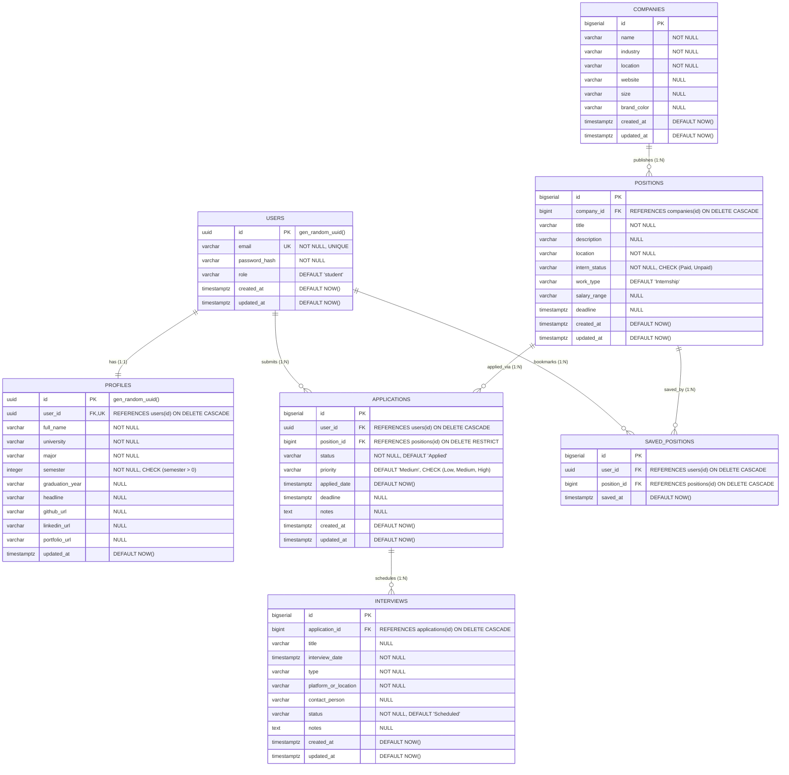

# DOKUMEN PERANCANGAN ERD & AUDIT SPESIFIKASI API
## Proyek: CareerTrack (Student Career & Application Tracking Web Application)
**Target Database:** PostgreSQL / Supabase  
**Scope Analisis:** Evaluasi Endpoint API Aktual (`application`, `company`, `interview`, `positions`, `profile`) & Perancangan Skema Database Relasional Ternormalisasi (3NF).

---

## 1. PEMERIKSAAN DETAIL API SETIAP FITUR AKTUAL

Pemeriksaan ini didasarkan pada penelusuran kode sumber aktual pada `apps/api/src/routes`, `apps/api/src/controllers`, dan `apps/api/src/middlewares/validation`.

```
apps/api/src/
├── routes/
│   ├── application.routes.js   --> /api/applications
│   ├── company.routes.js       --> /api/companies
│   ├── interview.routes.js     --> /api/interview (Singular)
│   ├── positions.routes.js     --> /api/positions
│   └── profiles.routes.js      --> /api/profiles (Plural)
├── controllers/
│   ├── application.controller.js
│   ├── company.controller.js
│   ├── interview.controller.js
│   ├── positions.controller.js
│   └── profiles.controller.js
└── middlewares/validation/
    ├── application.validate.js
    ├── company.validate.js
    ├── interview.validate.js
    ├── position.validate.js
    └── profile.validate.js
```

---

### 1.1. Fitur `Companies` (`/api/companies`)

Modul untuk mengelola katalog direktori perusahaan mitra/perekrut.

* **Prefix Route:** `/api/companies` (di-mount pada `app.js:16`)
* **File Terkait:**
  * Route: `apps/api/src/routes/company.routes.js`
  * Controller: `apps/api/src/controllers/company.controller.js`
  * Validator: `apps/api/src/middlewares/validation/company.validate.js`

#### A. Matriks Endpoint & Spesifikasi
| HTTP Method | Endpoint | Handler | Middleware Validasi | Status Respon Sukses | Respon Gagal / Error |
|---|---|---|---|---|---|
| `GET` | `/api/companies` | `getAllCompanies` | - | `200 OK` (Array) | - |
| `GET` | `/api/companies/:id` | `getCompanyById` | - | `200 OK` (Object) | `404 Not Found` via `next(error)` |
| `POST` | `/api/companies` | `postAllCompany` | `validateCompany` | `201 Created` (Object) | `400 Bad Request` |
| `PUT` | `/api/companies/:id` | `putCompanyById` | `validateCompany` | `200 OK` (Object) | `400 Bad Request` / `404 Not Found` |
| `DELETE` | `/api/companies/:id` | `delCompanyById` | - | `200 OK` (`{ message }`) | `404 Not Found` via `next(error)` |

#### B. Struktur Data Dummy & Payload
* **Atribut Aktual Controller:**
  ```javascript
  {
    id: 1,                          // integer
    name: "Telkom Indonesia",       // string (min 3, max 100)
    industry: "Telecommunication",  // string
    location: "Bandung",            // string
    website: "https://telkom.co.id" // string (URL)
  }
  ```
* **Aturan Validasi (`company.validate.js`):**
  * `name`, `industry`, `location`, `website` wajib diisi (`required`).
  * Seluruh field harus bertipe `string` dan tidak boleh hanya berisi whitespace.
  * `name` memiliki batasan panjang 3 - 100 karakter.
* **Evaluasi & Catatan Desain Database:**
  * Konsistensi error handling sudah baik (memanfaatkan centralized `next(error)`).
  * Perlu ditambahkan metadata timestamp (`created_at`, `updated_at`).
  * Field opsional pendukung frontend (`size`, `brand_color`) dapat disediakan di tingkat tabel.

---

### 1.2. Fitur `Positions` (`/api/positions`)

Modul untuk mengelola lowongan magang / pekerjaan yang tersedia.

* **Prefix Route:** `/api/positions` (di-mount pada `app.js:15`)
* **File Terkait:**
  * Route: `apps/api/src/routes/positions.routes.js`
  * Controller: `apps/api/src/controllers/positions.controller.js`
  * Validator: `apps/api/src/middlewares/validation/position.validate.js`

#### A. Matriks Endpoint & Spesifikasi
| HTTP Method | Endpoint | Handler | Middleware Validasi | Status Respon Sukses | Respon Gagal / Error |
|---|---|---|---|---|---|
| `GET` | `/api/positions` | `getAllPositions` | - | `200 OK` (Array) | - |
| `GET` | `/api/positions/:id` | `getPositionById` | - | `200 OK` (Object) | `404 Not Found` via `next(error)` |
| `POST` | `/api/positions` | `postAllPosition` | `validatePosition` | `201 Created` (Object) | `400 Bad Request` |
| `PUT` | `/api/positions/:id` | `putPositionById` | `validatePosition` | `200 OK` (Object) | `400 Bad Request` / `404 Not Found` (Direct res.status) |
| `DELETE` | `/api/positions/:id` | `delPositionById` | - | `200 OK` (`{ message }`) | `404 Not Found` (Direct res.status) |
| `PATCH` | `/api/positions/:id` | - | - | **Nonaktif** | Rute di-comment (`positions.routes.js:31`) |

#### B. Struktur Data Dummy & Payload
* **Atribut Aktual Controller:**
  ```javascript
  {
    id: 1,                          // integer
    name: "ML Engineer",            // string (judul posisi, 3-50 chars)
    industry: "Telecommunication",  // string
    location: "Bandung",            // string
    InternStatus: "Paid"            // string enum: "Paid" | "Unpaid"
  }
  ```
* **Aturan Validasi (`position.validate.js`):**
  * `name`, `industry`, `location`, `InternStatus` wajib diisi (`required`).
  * Bertipe string dan tidak kosong.
  * `name` panjangnya 3 - 50 karakter.
  * `InternStatus` wajib bernilai `"Paid"` atau `"Unpaid"`.
* **Evaluasi & Catatan Desain Database:**
  * **Ketiadaan Foreign Key:** Pada controller dummy, `positions` berdiri sendiri tanpa relasi ke `companies`. Di database relasional, sebuah posisi lowongan **harus** memiliki `company_id` yang mereferensikan tabel `companies`.
  * **Standarisasi Kolom:** Field `name` merepresentasikan judul posisi sehingga di database dinamakan `title`. Field `industry` redundan karena industri melekat pada entitas perusahaan (`companies.industry`).
  * **Inkonsistensi Error:** Pada `putPositionById` dan `delPositionById`, respon 404 dipanggil langsung via `res.status(404).json(...)` bukan melalui `next(error)`.

---

### 1.3. Fitur `Applications` (`/api/applications`)

Modul utama untuk pelacakan alur lamaran mahasiswa.

* **Prefix Route:** `/api/applications` (di-mount pada `app.js:17`)
* **File Terkait:**
  * Route: `apps/api/src/routes/application.routes.js`
  * Controller: `apps/api/src/controllers/application.controller.js`
  * Validator: `apps/api/src/middlewares/validation/application.validate.js`

#### A. Matriks Endpoint & Spesifikasi
| HTTP Method | Endpoint | Handler | Middleware Validasi | Status Respon Sukses | Respon Gagal / Error |
|---|---|---|---|---|---|
| `GET` | `/api/applications` | `getAllApplications` | - | `200 OK` (Array) | - |
| `GET` | `/api/applications/:id` | `getApplicationById` | - | `200 OK` (Object) | `404 Not Found` (Direct res.status) |
| `POST` | `/api/applications` | `createApplication` | `validateApplicationBody` | `201 Created` (Object) | `400 Bad Request` |
| `PUT` | `/api/applications/:id` | `updateApplication` | `validateApplicationBody` | `200 OK` (Object) | `400 Bad Request` / `404 Not Found` |
| `PATCH` | `/api/applications/:id` | `patchApplication` | - | `200 OK` (Object) | `404 Not Found` |
| `DELETE` | `/api/applications/:id` | `deleteApplication` | - | `200 OK` (`{ message }`) | `404 Not Found` (Direct res.status) |

#### B. Struktur Data Dummy & Payload
* **Atribut Aktual Controller:**
  ```javascript
  {
    id: 1,                  // integer
    company: "PT OTW KAYA", // string (nama perusahaan teks biasa)
    position: "QA",         // string (nama posisi teks biasa)
    status: "Applied",      // string ("Applied", "Interview", "Rejected", dst.)
    deadline: "2026-03-30"  // string (format tanggal YYYY-MM-DD)
  }
  ```
* **Aturan Validasi (`application.validate.js`):**
  * `company`, `position`, `status`, `deadline` wajib diisi. Jika salah satu kosong, mengembalikan 400 Bad Request.
* **Evaluasi & Catatan Desain Database:**
  * **Pelanggaran Normalisasi (Denormalisasi Parsial):** Pada kode dummy, `company` dan `position` disimpan sebagai *flat string*. Dalam database relasional ternormalisasi (3NF), lamaran merujuk ke `position_id` (FK ke `positions`). Melalui relasi ke `positions`, nama perusahaan dapat diambil langsung melalui `positions.company_id -> companies.name` tanpa duplikasi string.
  * **Kepemilikan Pengguna (`user_id`):** Lamaran bersifat personal per mahasiswa. Tabel database wajib memiliki `user_id` yang mereferensikan akun mahasiswa.
  * **Status Pipeline:** Di frontend dan siklus karir mahasiswa, status lamaran mengikuti tahapan: `Wishlist`, `Applied`, `Assessment`, `Interview`, `Offer`, `Rejected`, `Withdrawn`.
  * **Rute PATCH:** Endpoint saat ini berada di `PATCH /api/applications/:id`, idealnya dapat difokuskan atau disinkronkan untuk pembaruan status lamaran (`stage / status`).

---

### 1.4. Fitur `Interview` (`/api/interview`)

Modul penjadwalan dan pencatatan sesi wawancara mahasiswa.

* **Prefix Route:** `/api/interview` (di-mount pada `app.js:18` - Catatan: Menggunakan bentuk singular)
* **File Terkait:**
  * Route: `apps/api/src/routes/interview.routes.js`
  * Controller: `apps/api/src/controllers/interview.controller.js`
  * Validator: `apps/api/src/middlewares/validation/interview.validate.js`

#### A. Matriks Endpoint & Spesifikasi
| HTTP Method | Endpoint | Handler | Middleware Validasi | Status Respon Sukses | Respon Gagal / Error |
|---|---|---|---|---|---|
| `GET` | `/api/interview` | `getAllInterviews` | - | `200 OK` (Array) | - |
| `GET` | `/api/interview/:id` | `getInterviewById` | - | `200 OK` (Object) | `404 Not Found` (Direct res.status) |
| `POST` | `/api/interview` | `createInterview` | `validateInterviewBody` | `201 Created` (Object) | `400 Bad Request` |
| `PUT` | `/api/interview/:id` | `updateInterview` | `validateInterviewBody` | `200 OK` (Object) | `400 Bad Request` / `404 Not Found` |
| `DELETE` | `/api/interview/:id` | `deleteInterview` | - | `200 OK` (`{ message }`) | `404 Not Found` (Direct res.status) |

#### B. Struktur Data Dummy & Payload
* **Atribut Aktual Controller:**
  ```javascript
  {
    id: 1,                                  // integer
    application_id: 1,                      // integer (relasi ke lamaran)
    company: "PT OTW KAYA",                 // string (duplikasi data)
    position: "QA",                         // string (duplikasi data)
    interview_date: "2026-04-01T10:00:00Z", // string ISO timestamp
    type: "Online (Google Meet)",           // string tipe wawancara
    status: "Scheduled"                     // string ("Scheduled", "Completed", "Cancelled")
  }
  ```
* **Aturan Validasi (`interview.validate.js`):**
  * Seluruh field di atas wajib diisi saat POST/PUT.
* **Evaluasi & Catatan Desain Database:**
  * **Redundansi Kritis (Transitive Dependency):** Menyimpan `company` dan `position` pada data `interviews` adalah bentuk anomali redundansi, karena data perusahaan dan posisi sudah pasti melekat pada `application_id`. Di skema 3NF, data tersebut dihapus dari tabel interview dan diperoleh melalui `JOIN applications -> positions -> companies`.
  * **Relasi:** 1 Lamaran dapat memiliki 1 atau lebih tahapan interview (1:N, misalnya: *HR Interview*, *Technical Interview*, *User Interview*).
  * **Naming Convention:** Routing aktual menggunakan singular `/api/interview`, sedangkan standar RESTful API umumnya jamak (`/api/interviews`).

---

### 1.5. Fitur `Profiles` (`/api/profiles`)

Modul identitas akademik, semester, dan portofolio mahasiswa.

* **Prefix Route:** `/api/profiles` (di-mount pada `app.js:19`)
* **File Terkait:**
  * Route: `apps/api/src/routes/profiles.routes.js`
  * Controller: `apps/api/src/controllers/profiles.controller.js`
  * Validator: `apps/api/src/middlewares/validation/profile.validate.js`

#### A. Matriks Endpoint & Spesifikasi
| HTTP Method | Endpoint | Handler | Middleware Validasi | Status Respon Sukses | Respon Gagal / Error |
|---|---|---|---|---|---|
| `GET` | `/api/profiles` | `getAllProfiles` | - | `200 OK` (Array) | - |
| `PUT` | `/api/profiles/:id` | `putProfileById` | `validateProfile` | `200 OK` (Object) | `400 Bad Request` / `404 Not Found` via `next(error)` |

#### B. Struktur Data Dummy & Payload
* **Atribut Aktual Controller:**
  ```javascript
  {
    id: 1,                                    // integer
    name: "Agus Teri",                        // string
    university: "Princeton University",       // string
    major: "Computer Science",                // string
    semester: 5,                              // integer (> 0)
    github: "https://github.com/agusteri",    // string URL
    linkedin: "https://linkedin.com/in/agusteri", // string URL
    portfolio: "https://agusteri.dev"         // string URL
  }
  ```
* **Aturan Validasi (`profile.validate.js`):**
  * `name`, `university`, `major`, `semester` wajib diisi.
  * `semester` harus bilangan integer positif (`Number.isInteger(Number(semester)) && semester >= 1`).
  * Field tautan sosial (`github`, `linkedin`, `portfolio`) bersifat opsional.
* **Evaluasi & Catatan Desain Database:**
  * **Relasi 1:1 ke User:** Profil mahasiswa harus memiliki `user_id` bertipe UUID yang bersifat `UNIQUE` dan menjadi Foreign Key ke tabel `users`.
  * **Konsep Singular Profil:** Mahasiswa hanya mengelola profil miliknya sendiri. Pada skema relasional terautentikasi, endpoint profil idealnya merujuk ke user yang sedang login (`req.user.id`).

---

## 2. REKAPITULASI TEMUAN & PERBAIKAN STRUKTUR DATA

| Entitas | Kondisi Kode Dummy Saat Ini | Masalah / Keterbatasan | Solusi Perancangan ERD Relasional |
|---|---|---|---|
| **`companies`** | Menyimpan id numerik lokal, nama, industri, lokasi, web. | ID dihasilkan via `.length + 1` (rawan tabrakan ID setelah delete). | Gunakan `BIGSERIAL` / Sequence Database. Tambahkan audit timestamp. |
| **`positions`** | Berdiri sendiri tanpa relasi ke `companies`. Menggunakan field `name`. | Lowongan tidak terhubung ke entitas perusahaan. Field nama ambigu. | Tambahkan `company_id` (FK ke `companies`). Ubah `name` menjadi `title`. |
| **`applications`** | Menyimpan teks biasa `company` & `position`. Tidak ada pemilik user. | Redundan, data lamaran terisolasi, tidak ada proteksi per-user. | Kaitkan ke `user_id` (FK ke `users`) dan `position_id` (FK ke `positions`). Hapus teks redundan. |
| **`interviews`** | Menyimpan teks `company` & `position` selain `application_id`. | Pelanggaran bentuk normal ke-3 (3NF) karena dependensi transitif. | Hapus kolom redundan. Hanya simpan `application_id` beserta metadata sesi interview. |
| **`profiles`** | Dummy array banyak profil dengan id mandiri. | Tidak terikat dengan sistem login/autentikasi pengguna. | Relasi 1:1 dengan `users` melalui kolom `user_id UNIQUE NOT NULL`. |

---

## 3. PERANCANGAN ENTITY RELATIONSHIP DIAGRAM (ERD)

Berdasarkan keseluruhan analisis endpoint API, validasi request, struktur data aktual, dan relasi alur bisnis aplikasi **CareerTrack**, berikut adalah arsitektur ERD PostgreSQL / Supabase yang lengkap:

### 3.1. Diagram ERD (Mermaid Relational Diagram)



---

### 3.2. Penjelasan Relasi & Kardinalitas Antar Entitas

1. **`USERS` ke `PROFILES` (One-to-One / `1:1`)**
   * **Kardinalitas:** 1 pengguna tepat memiliki 1 baris profil akademik.
   * **Implementasi:** Kolom `profiles.user_id` memiliki constraint `UNIQUE NOT NULL` dan `FOREIGN KEY (user_id) REFERENCES users(id) ON DELETE CASCADE`.
   * **Integritas:** Jika user dihapus, profil terkait otomatis terhapus (*cascade*).

2. **`COMPANIES` ke `POSITIONS` (One-to-Many / `1:N`)**
   * **Kardinalitas:** 1 perusahaan dapat mempublikasikan banyak lowongan posisi magang/pekerjaan, sedangkan 1 posisi dimiliki oleh tepat 1 perusahaan.
   * **Implementasi:** Kolom `positions.company_id` mereferensikan `companies.id` dengan aturan `ON DELETE CASCADE`.

3. **`USERS` ke `APPLICATIONS` (One-to-Many / `1:N`)**
   * **Kardinalitas:** 1 mahasiswa dapat melacak banyak lamaran ke berbagai posisi pekerjaan yang diminatinya.
   * **Implementasi:** Kolom `applications.user_id` mereferensikan `users.id` dengan aturan `ON DELETE CASCADE`.

4. **`POSITIONS` ke `APPLICATIONS` (One-to-Many / `1:N`)**
   * **Kardinalitas:** 1 posisi lowongan dapat dilamar oleh banyak pelamar/mahasiswa.
   * **Implementasi:** Kolom `applications.position_id` mereferensikan `positions.id` dengan aturan `ON DELETE RESTRICT` (mencegah lowongan dihapus tidak sengaja jika sudah terdapat histori lamaran mahasiswa aktif).

5. **`APPLICATIONS` ke `INTERVIEWS` (One-to-Many / `1:N`)**
   * **Kardinalitas:** 1 lamaran kerja dapat memiliki banyak tahapan wawancara (misalnya *HR Screening*, *Technical Coding Round*, hingga *User / Manager Interview*).
   * **Implementasi:** Kolom `interviews.application_id` mereferensikan `applications.id` dengan aturan `ON DELETE CASCADE`.

6. **`USERS` ke `SAVED_POSITIONS` ke `POSITIONS` (Many-to-Many / `M:N`)**
   * **Kardinalitas:** 1 mahasiswa dapat menyimpan/menandai (bookmark) banyak posisi favorit, dan 1 posisi dapat disimpan oleh banyak mahasiswa.
   * **Implementasi:** Tabel junction `saved_positions` dengan unique constraint kombinasi `(user_id, position_id)`.

---

## 4. KAMUS DATA (DATA DICTIONARY)

Berikut rincian spesifikasi teknis kolom, tipe data, nilai bawaan, dan batasan (*constraints*) untuk setiap tabel.

### 4.1. Tabel `users`
Menyimpan kredensial otentikasi akun pengguna.

| Nama Kolom | Tipe Data | Constraint | Deskripsi |
|---|---|---|---|
| `id` | `UUID` | `PRIMARY KEY`, `DEFAULT gen_random_uuid()` | ID unik pengguna |
| `email` | `VARCHAR(255)` | `NOT NULL`, `UNIQUE` | Alamat surel unik untuk autentikasi login |
| `password_hash` | `VARCHAR(255)` | `NOT NULL` | Hash kata sandi pengguna (Bcrypt) |
| `role` | `VARCHAR(50)` | `NOT NULL`, `DEFAULT 'student'` | Hak akses pengguna (`student`, `admin`) |
| `created_at` | `TIMESTAMPTZ` | `NOT NULL`, `DEFAULT NOW()` | Waktu registrasi akun |
| `updated_at` | `TIMESTAMPTZ` | `NOT NULL`, `DEFAULT NOW()` | Waktu pembaruan data pengguna |

---

### 4.2. Tabel `profiles`
Menyimpan rincian identitas akademik dan tautan profesional mahasiswa (Relasi 1:1 dengan `users`).

| Nama Kolom | Tipe Data | Constraint | Deskripsi |
|---|---|---|---|
| `id` | `UUID` | `PRIMARY KEY`, `DEFAULT gen_random_uuid()` | ID unik profil |
| `user_id` | `UUID` | `NOT NULL`, `UNIQUE`, `FK -> users(id) ON DELETE CASCADE` | Relasi pemilik profil |
| `full_name` | `VARCHAR(150)` | `NOT NULL` | Nama lengkap mahasiswa |
| `university` | `VARCHAR(150)` | `NOT NULL` | Nama perguruan tinggi asal |
| `major` | `VARCHAR(100)` | `NOT NULL` | Program studi / jurusan |
| `semester` | `INT` | `NOT NULL`, `CHECK (semester > 0)` | Semester perkuliahan saat ini |
| `graduation_year` | `VARCHAR(10)` | `NULL` | Ekspektasi tahun kelulusan |
| `headline` | `VARCHAR(150)` | `NULL` | Tajuk singkat profil (e.g. *CS Student & Frontend Dev*) |
| `github_url` | `VARCHAR(255)` | `NULL` | Tautan profil GitHub |
| `linkedin_url` | `VARCHAR(255)` | `NULL` | Tautan profil LinkedIn |
| `portfolio_url` | `VARCHAR(255)` | `NULL` | Tautan situs portofolio web |
| `updated_at` | `TIMESTAMPTZ` | `NOT NULL`, `DEFAULT NOW()` | Waktu modifikasi profil |

---

### 4.3. Tabel `companies`
Katalog data perusahaan perekrut / mitra.

| Nama Kolom | Tipe Data | Constraint | Deskripsi |
|---|---|---|---|
| `id` | `BIGSERIAL` | `PRIMARY KEY` | ID unik perusahaan |
| `name` | `VARCHAR(150)` | `NOT NULL` | Nama resmi perusahaan |
| `industry` | `VARCHAR(100)` | `NOT NULL` | Sektor industri (*Technology, FinTech, Telco*) |
| `location` | `VARCHAR(150)` | `NOT NULL` | Lokasi operasional / kantor pusat |
| `website` | `VARCHAR(255)` | `NULL` | Tautan portal resmi perusahaan |
| `size` | `VARCHAR(50)` | `NULL` | Rentang jumlah karyawan (e.g. *51–200*) |
| `brand_color` | `VARCHAR(20)` | `NULL` | Kode hex warna aksen perusahaan untuk UI (*#6366F1*) |
| `created_at` | `TIMESTAMPTZ` | `NOT NULL`, `DEFAULT NOW()` | Waktu penambahan entri |
| `updated_at` | `TIMESTAMPTZ` | `NOT NULL`, `DEFAULT NOW()` | Waktu pembaruan data |

---

### 4.4. Tabel `positions`
Katalog lowongan magang atau pekerjaan yang dibuka perusahaan.

| Nama Kolom | Tipe Data | Constraint | Deskripsi |
|---|---|---|---|
| `id` | `BIGSERIAL` | `PRIMARY KEY` | ID unik posisi lowongan |
| `company_id` | `BIGINT` | `NOT NULL`, `FK -> companies(id) ON DELETE CASCADE` | Perusahaan pemilik lowongan |
| `title` | `VARCHAR(150)` | `NOT NULL` | Nama posisi (e.g. *Frontend Engineer Intern*) |
| `description` | `TEXT` | `NULL` | Uraian tugas & kualifikasi posisi |
| `location` | `VARCHAR(150)` | `NOT NULL` | Lokasi penempatan kerja (*Jakarta (Hybrid)*) |
| `intern_status` | `VARCHAR(20)` | `NOT NULL`, `CHECK (intern_status IN ('Paid', 'Unpaid'))` | Status kompensasi magang |
| `work_type` | `VARCHAR(50)` | `NOT NULL`, `DEFAULT 'Internship'` | Tipe ikatan kerja (*Internship, Full-time*) |
| `salary_range` | `VARCHAR(100)` | `NULL` | Estimasi remunerasi per bulan/jam |
| `deadline` | `TIMESTAMPTZ` | `NULL` | Batas akhir pengiriman lamaran |
| `created_at` | `TIMESTAMPTZ` | `NOT NULL`, `DEFAULT NOW()` | Waktu publikasi lowongan |
| `updated_at` | `TIMESTAMPTZ` | `NOT NULL`, `DEFAULT NOW()` | Waktu pembaruan lowongan |

---

### 4.5. Tabel `applications`
Entitas transaksi pelacakan proses lamaran oleh mahasiswa.

| Nama Kolom | Tipe Data | Constraint | Deskripsi |
|---|---|---|---|
| `id` | `BIGSERIAL` | `PRIMARY KEY` | ID unik pelacakan lamaran |
| `user_id` | `UUID` | `NOT NULL`, `FK -> users(id) ON DELETE CASCADE` | Mahasiswa pelamar |
| `position_id` | `BIGINT` | `NOT NULL`, `FK -> positions(id) ON DELETE RESTRICT` | Posisi yang dilamar |
| `status` | `VARCHAR(30)` | `NOT NULL`, `DEFAULT 'Applied'`, `CHECK status IN ('Wishlist','Applied','Assessment','Interview','Offer','Rejected','Withdrawn')` | Status tahapan seleksi saat ini |
| `priority` | `VARCHAR(20)` | `NOT NULL`, `DEFAULT 'Medium'`, `CHECK priority IN ('Low','Medium','High')` | Tingkat prioritas bagi mahasiswa |
| `applied_date` | `TIMESTAMPTZ` | `NOT NULL`, `DEFAULT NOW()` | Tanggal pengajuan lamaran |
| `deadline` | `TIMESTAMPTZ` | `NULL` | Tanggal batas respon/tindak lanjut |
| `notes` | `TEXT` | `NULL` | Catatan refleksi / tips persiapan pelamar |
| `created_at` | `TIMESTAMPTZ` | `NOT NULL`, `DEFAULT NOW()` | Waktu pencatatan data |
| `updated_at` | `TIMESTAMPTZ` | `NOT NULL`, `DEFAULT NOW()` | Waktu update status terakhir |

---

### 4.6. Tabel `interviews`
Jadwal dan rincian sesi wawancara terkait lamaran mahasiswa.

| Nama Kolom | Tipe Data | Constraint | Deskripsi |
|---|---|---|---|
| `id` | `BIGSERIAL` | `PRIMARY KEY` | ID unik sesi interview |
| `application_id` | `BIGINT` | `NOT NULL`, `FK -> applications(id) ON DELETE CASCADE` | ID lamaran yang sedang berjalan |
| `title` | `VARCHAR(150)` | `NULL` | Judul sesi (*HR Round, System Design*) |
| `interview_date` | `TIMESTAMPTZ` | `NOT NULL` | Waktu pelaksanaan wawancara |
| `type` | `VARCHAR(100)` | `NOT NULL` | Format interview (*Online (Google Meet), On-site*) |
| `platform_or_location` | `VARCHAR(255)` | `NOT NULL` | URL tautan panggilan atau alamat fisik |
| `contact_person` | `VARCHAR(150)` | `NULL` | Nama pewawancara / penanggung jawab |
| `status` | `VARCHAR(30)` | `NOT NULL`, `DEFAULT 'Scheduled'`, `CHECK status IN ('Scheduled','Completed','Cancelled','Rescheduled')` | Status pelaksanaan interview |
| `notes` | `TEXT` | `NULL` | Feedback atau rangkuman hasil wawancara |
| `created_at` | `TIMESTAMPTZ` | `NOT NULL`, `DEFAULT NOW()` | Waktu penambahan jadwal |
| `updated_at` | `TIMESTAMPTZ` | `NOT NULL`, `DEFAULT NOW()` | Waktu perubahan jadwal |

---

### 4.7. Tabel `saved_positions` (Opsional / Relasi Pendukung)
Menyimpan posisi yang ditandai/disimpan oleh mahasiswa sebelum melamar.

| Nama Kolom | Tipe Data | Constraint | Deskripsi |
|---|---|---|---|
| `id` | `BIGSERIAL` | `PRIMARY KEY` | ID penanda |
| `user_id` | `UUID` | `NOT NULL`, `FK -> users(id) ON DELETE CASCADE` | Mahasiswa yang menandai |
| `position_id` | `BIGINT` | `NOT NULL`, `FK -> positions(id) ON DELETE CASCADE` | Posisi yang ditandai |
| `saved_at` | `TIMESTAMPTZ` | `NOT NULL`, `DEFAULT NOW()` | Waktu penandaan |

*Constraint Tambahan:* `UNIQUE (user_id, position_id)` (mencegah duplikasi bookmark).

---

## 5. ANALISIS NORMALISASI DATABASE (1NF, 2NF, 3NF)

Desain basis data di atas menjamin kebersihan data dari redundansi serta anomali insert, update, dan delete:

1. **Bentuk Normal Pertama (1NF - Atomic Values & No Repeating Groups):**
   * Semua nilai atribut bersifat atomik (tidak ada multivalue array string seperti tag atau list gabungan yang disimpan tanpa entitas terstruktur).
   * Setiap tabel memiliki Primary Key unik (`id`).
2. **Bentuk Normal Kedua (2NF - Full Functional Dependency):**
   * Memenuhi 1NF.
   * Seluruh Primary Key berjenis *Single Column Primary Key* (`BIGSERIAL` atau `UUID`). Oleh karena itu, tidak ada atribut non-kunci yang bergantung pada sebagian kunci (*no partial dependencies*).
3. **Bentuk Normal Ketiga (3NF - Elimination of Transitive Dependencies):**
   * Memenuhi 2NF.
   * **Perbaikan Krusial dari Kode Dummy:**
     * Pada kode dummy controller `applications`, field `company` disimpan sebagai teks. Jika nama perusahaan berganti, terjadi anomali update. Di skema baru, `applications` hanya menyimpan `position_id`, sedangkan nama perusahaan diambil via `positions.company_id -> companies.name`.
     * Pada kode dummy controller `interviews`, field `company` dan `position` disimpan berulang kali. Ini merupakan pelanggaran 3NF murni karena:
       $$\text{interview\_id} \rightarrow \text{application\_id} \rightarrow \text{position\_id} \rightarrow \text{company\_id}$$
     * Di skema relasional baru, redundansi tersebut dieliminasi sepenuhnya. Seluruh informasi perusahaan dan posisi diakses menggunakan relasi `JOIN`.

---

## 6. SKRIP DDL POSTGRESQL / SUPABASE (READY TO EXECUTE)

Skrip SQL berikut dapat langsung dieksekusi pada SQL Editor Supabase atau terminal PostgreSQL (`psql`).

```sql
-- ============================================================================
-- SKEMA BASIS DATA RELASIONAL: CAREERTRACK (STUDENT CAREER & APPLICATION TRACK)
-- Engine: PostgreSQL 14+ / Supabase
-- ============================================================================

-- 1. Inisialisasi Ekstensi Kriptografi & UUID
CREATE EXTENSION IF NOT EXISTS "pgcrypto";

-- 2. TABEL: users
CREATE TABLE IF NOT EXISTS users (
    id UUID PRIMARY KEY DEFAULT gen_random_uuid(),
    email VARCHAR(255) UNIQUE NOT NULL,
    password_hash VARCHAR(255) NOT NULL,
    role VARCHAR(50) NOT NULL DEFAULT 'student',
    created_at TIMESTAMPTZ NOT NULL DEFAULT NOW(),
    updated_at TIMESTAMPTZ NOT NULL DEFAULT NOW()
);

-- 3. TABEL: profiles (1:1 dengan users)
CREATE TABLE IF NOT EXISTS profiles (
    id UUID PRIMARY KEY DEFAULT gen_random_uuid(),
    user_id UUID UNIQUE NOT NULL REFERENCES users(id) ON DELETE CASCADE,
    full_name VARCHAR(150) NOT NULL,
    university VARCHAR(150) NOT NULL,
    major VARCHAR(100) NOT NULL,
    semester INT NOT NULL CHECK (semester > 0),
    graduation_year VARCHAR(10),
    headline VARCHAR(150),
    github_url VARCHAR(255),
    linkedin_url VARCHAR(255),
    portfolio_url VARCHAR(255),
    updated_at TIMESTAMPTZ NOT NULL DEFAULT NOW()
);

-- 4. TABEL: companies
CREATE TABLE IF NOT EXISTS companies (
    id BIGSERIAL PRIMARY KEY,
    name VARCHAR(150) NOT NULL,
    industry VARCHAR(100) NOT NULL,
    location VARCHAR(150) NOT NULL,
    website VARCHAR(255),
    size VARCHAR(50),
    brand_color VARCHAR(20),
    created_at TIMESTAMPTZ NOT NULL DEFAULT NOW(),
    updated_at TIMESTAMPTZ NOT NULL DEFAULT NOW()
);

-- 5. TABEL: positions (N:1 dengan companies)
CREATE TABLE IF NOT EXISTS positions (
    id BIGSERIAL PRIMARY KEY,
    company_id BIGINT NOT NULL REFERENCES companies(id) ON DELETE CASCADE,
    title VARCHAR(150) NOT NULL,
    description TEXT,
    location VARCHAR(150) NOT NULL,
    intern_status VARCHAR(20) NOT NULL CHECK (intern_status IN ('Paid', 'Unpaid')),
    work_type VARCHAR(50) NOT NULL DEFAULT 'Internship',
    salary_range VARCHAR(100),
    deadline TIMESTAMPTZ,
    created_at TIMESTAMPTZ NOT NULL DEFAULT NOW(),
    updated_at TIMESTAMPTZ NOT NULL DEFAULT NOW()
);

-- 6. TABEL: applications (N:1 dengan users dan N:1 dengan positions)
CREATE TABLE IF NOT EXISTS applications (
    id BIGSERIAL PRIMARY KEY,
    user_id UUID NOT NULL REFERENCES users(id) ON DELETE CASCADE,
    position_id BIGINT NOT NULL REFERENCES positions(id) ON DELETE RESTRICT,
    status VARCHAR(30) NOT NULL DEFAULT 'Applied' CHECK (
        status IN ('Wishlist', 'Applied', 'Assessment', 'Interview', 'Offer', 'Rejected', 'Withdrawn')
    ),
    priority VARCHAR(20) NOT NULL DEFAULT 'Medium' CHECK (
        priority IN ('Low', 'Medium', 'High')
    ),
    applied_date TIMESTAMPTZ NOT NULL DEFAULT NOW(),
    deadline TIMESTAMPTZ,
    notes TEXT,
    created_at TIMESTAMPTZ NOT NULL DEFAULT NOW(),
    updated_at TIMESTAMPTZ NOT NULL DEFAULT NOW()
);

-- 7. TABEL: interviews (N:1 dengan applications)
CREATE TABLE IF NOT EXISTS interviews (
    id BIGSERIAL PRIMARY KEY,
    application_id BIGINT NOT NULL REFERENCES applications(id) ON DELETE CASCADE,
    title VARCHAR(150),
    interview_date TIMESTAMPTZ NOT NULL,
    type VARCHAR(100) NOT NULL,
    platform_or_location VARCHAR(255) NOT NULL,
    contact_person VARCHAR(150),
    status VARCHAR(30) NOT NULL DEFAULT 'Scheduled' CHECK (
        status IN ('Scheduled', 'Completed', 'Cancelled', 'Rescheduled')
    ),
    notes TEXT,
    created_at TIMESTAMPTZ NOT NULL DEFAULT NOW(),
    updated_at TIMESTAMPTZ NOT NULL DEFAULT NOW()
);

-- 8. TABEL: saved_positions (Bookmark / Many-to-Many antara users dan positions)
CREATE TABLE IF NOT EXISTS saved_positions (
    id BIGSERIAL PRIMARY KEY,
    user_id UUID NOT NULL REFERENCES users(id) ON DELETE CASCADE,
    position_id BIGINT NOT NULL REFERENCES positions(id) ON DELETE CASCADE,
    saved_at TIMESTAMPTZ NOT NULL DEFAULT NOW(),
    CONSTRAINT uq_user_position_saved UNIQUE (user_id, position_id)
);

-- ============================================================================
-- INDEKS OPTIMASI QUERY (FOREIGN KEYS & PENCARIAN CEPAT)
-- ============================================================================
CREATE INDEX IF NOT EXISTS idx_positions_company_id ON positions(company_id);
CREATE INDEX IF NOT EXISTS idx_applications_user_id ON applications(user_id);
CREATE INDEX IF NOT EXISTS idx_applications_position_id ON applications(position_id);
CREATE INDEX IF NOT EXISTS idx_applications_status ON applications(status);
CREATE INDEX IF NOT EXISTS idx_interviews_application_id ON interviews(application_id);
CREATE INDEX IF NOT EXISTS idx_saved_positions_user_id ON saved_positions(user_id);

-- ============================================================================
-- TRIGGER OTOMATISASI UPDATED_AT (OPSIONAL TAPI DIREKOMENDASIKAN)
-- ============================================================================
CREATE OR REPLACE FUNCTION update_timestamp_column()
RETURNS TRIGGER AS $$
BEGIN
    NEW.updated_at = NOW();
    RETURN NEW;
END;
$$ LANGUAGE 'plpgsql';

CREATE TRIGGER trg_users_updated_at BEFORE UPDATE ON users FOR EACH ROW EXECUTE PROCEDURE update_timestamp_column();
CREATE TRIGGER trg_profiles_updated_at BEFORE UPDATE ON profiles FOR EACH ROW EXECUTE PROCEDURE update_timestamp_column();
CREATE TRIGGER trg_companies_updated_at BEFORE UPDATE ON companies FOR EACH ROW EXECUTE PROCEDURE update_timestamp_column();
CREATE TRIGGER trg_positions_updated_at BEFORE UPDATE ON positions FOR EACH ROW EXECUTE PROCEDURE update_timestamp_column();
CREATE TRIGGER trg_applications_updated_at BEFORE UPDATE ON applications FOR EACH ROW EXECUTE PROCEDURE update_timestamp_column();
CREATE TRIGGER trg_interviews_updated_at BEFORE UPDATE ON interviews FOR EACH ROW EXECUTE PROCEDURE update_timestamp_column();
```

---

## 7. MATRIKS TRANSISI DARI KODE DUMMY KE QUERY SQL DATABASE

Berikut panduan refactoring bagi developer saat melakukan migrasi handler controller dari operasi array in-memory ke SQL Query:

| Fungsi Controller | Operasi Array Saat Ini | Query SQL Pengganti (Parameterized Query) |
|---|---|---|
| `getAllCompanies` | `res.json(companies)` | `SELECT * FROM companies ORDER BY id ASC` |
| `getCompanyById` | `companies.find(c => c.id === id)` | `SELECT * FROM companies WHERE id = $1` |
| `postAllCompany` | `companies.push(newCompany)` | `INSERT INTO companies (name, industry, location, website) VALUES ($1, $2, $3, $4) RETURNING *` |
| `getAllPositions` | `res.json(positions)` | `SELECT p.*, c.name AS company_name, c.industry FROM positions p JOIN companies c ON p.company_id = c.id` |
| `postAllPosition` | `positions.push(newPosition)` | `INSERT INTO positions (company_id, title, location, intern_status) VALUES ($1, $2, $3, $4) RETURNING *` |
| `getAllApplications`| `res.json(applications)` | `SELECT a.*, p.title AS position_title, c.name AS company_name FROM applications a JOIN positions p ON a.position_id = p.id JOIN companies c ON p.company_id = c.id WHERE a.user_id = $1` |
| `createApplication` | `applications.push(newApplication)`| `INSERT INTO applications (user_id, position_id, status, deadline, notes) VALUES ($1, $2, $3, $4, $5) RETURNING *` |
| `patchApplication`  | `appItem.status = status` | `UPDATE applications SET status = $1, updated_at = NOW() WHERE id = $2 AND user_id = $3 RETURNING *` |
| `getAllInterviews`  | `res.json(interviews)` | `SELECT i.*, p.title AS position_title, c.name AS company_name FROM interviews i JOIN applications a ON i.application_id = a.id JOIN positions p ON a.position_id = p.id JOIN companies c ON p.company_id = c.id WHERE a.user_id = $1` |
| `putProfileById`    | `profile = { ...req.body }` | `UPDATE profiles SET full_name = $1, university = $2, major = $3, semester = $4, github_url = $5, linkedin_url = $6, portfolio_url = $7 WHERE user_id = $8 RETURNING *` |

---

## 8. KESIMPULAN

1. **Kelengkapan Fitur:** Kelima fitur inti (`company`, `positions`, `application`, `interview`, dan `profile`) telah memiliki rute dan validasi payload yang terdefinisi dengan jelas di level REST API.
2. **Kesiapan Skema ERD:** Skema relasional yang dirancang telah mengeliminasi seluruh redundansi string dummy, memenuhi kaidah normalisasi **Third Normal Form (3NF)**, dan dilengkapi referensi integritas *Foreign Key Cascading* yang solid.
3. **Kompatibilitas Penuh:** Skema ini siap diimplementasikan langsung pada PostgreSQL maupun Supabase, sekaligus mendukung kebutuhan analitik dashboard maupun fitur bookmark di frontend `apps/web`.
